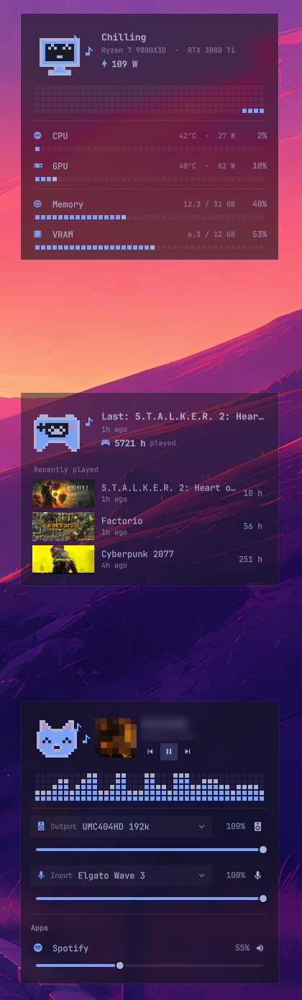
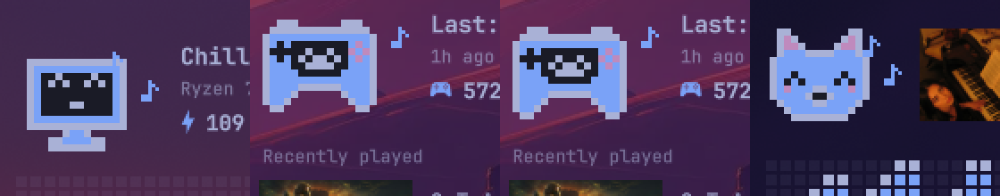
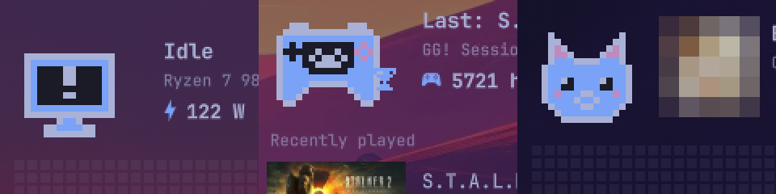
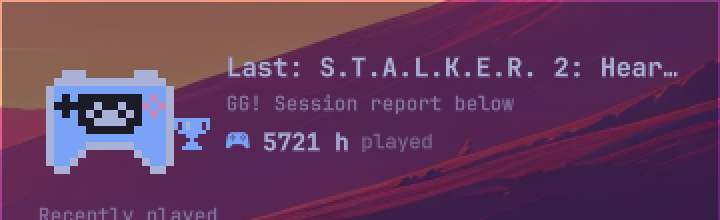

# desk-pets 🐱🖥️🎮

Pixel-art desktop cards with little pixel pets for [Omarchy](https://omarchy.org) (Arch + Hyprland).
They live on the desktop layer, under your windows and above the wallpaper, and follow your Omarchy theme
live. The pets react to your music, your PC's load, your games, and to each other.

**They're built for gaming PCs:** every card stops doing work the moment a window covers it. The data comes
from tiny Rust helpers that sleep until they're asked or something changes.

<p align="center"></p>

## What's inside

| | Card | What it shows |
|---|---|---|
| 🖥️ | **Desk System** (`fynnp.desksys`) | CPU / GPU / RAM / VRAM load, temperatures, **watts** (CPU via RAPL, NVIDIA via NVML, AMD via sysfs), 40 s load history. A pixel computer that dozes, works, sweats and catches fire. |
| 🥧 | **Desk Memory** (`fynnp.deskmem`) | What's eating your RAM: a pixel-art pie of the six biggest apps (browser renderers, Electron and Steam helpers folded into their app), the rest and what's free, with a legend. Turns urgent above 90 %. |
| 💾 | **Desk Disk** (`fynnp.deskdisk`) | Every real filesystem (btrfs subvolumes merged) with a usage meter and free space, root usage, read/write rates and a 40 s mirrored I/O history. A pixel floppy that dozes, slides its shutter when the disks work hard and sweats when a drive is over 90 % full. |
| 🎧 | **Desk Audio** (`fynnp.deskaudio`) | Now playing (MPRIS) with art and controls, a block-cell visualizer, output/input device pickers with volume, a per-app mixer. A cat that dances to your music. |
| 🎮 | **Desk Games** (`fynnp.deskgames`) | Recently played Steam games with covers, one click to launch, live "Playing · 0:42", and the **last session report** (avg FPS, 1 % low, peak temps, kWh). A gamepad critter that mashes buttons and holds up a trophy. |
| 📡 | **Desk Net** (`fynnp.desknet`) | Default-route interface and IPv4, live ↓/↑ rates, a 40 s mirrored throughput history, totals since the card started. A pixel router that dozes when the line is quiet, flickers its LEDs and passes packets when busy, and flops its antennas when you're offline. |
| 🦉 | **Desk Clock** (`fynnp.deskclock`) | The time, the date, how far through the day, week and year you are, and uptime. An owl on a branch with a pocket watch that shows the real time: it checks the watch, swivels its head right round, hoots the hour on the hour (visual only, no sound) and sleeps at night. |
| 🌙 | **Cat screensaver** (`fynnp.catsaver`) | A sleeping pixel cat with a swishing tail, breathing, drifting z's, a moon and twinkling stars, on every monitor. |
| ✋ | **Layout mode** (`fynnp.desklayout`) | **SUPER + ALT + E**: drag the cards anywhere on a snapping grid, nudge them with the arrow keys, send them to another monitor. |

<p align="center">
  
</p>

### The pets talk to each other

The cards share their moods through tiny files in `$XDG_RUNTIME_DIR` that are watched with inotify, never
polled:

- When music plays, the cat dances, the computer grooves with notes rising beside it, and the gamepad bops.
- When the PC is under load, the cat looks up at the stressed computer with its ears flat, and the gamepad
  sweats.
- When a game is launching, a big **!** appears on the computer's screen and the cat's ears perk up.
- When nothing is happening, everybody sleeps, with their z's in sync.
- Every few minutes a relaxed pet looks toward a neighbouring card and sends it something: the penguin a
  paper plane, the hamster a sunflower seed, the cat a music note, the dachshund a bone, the pigeon an
  envelope, the axolotl a bubble. It flies off one card and in on the other, where the neighbour looks
  back (a sleeping one opens its eyes) and the gift pops into a little heart. Off with `petMotion: "calm"`.

<p align="center"></p>

### Game session reports

With `--sessions`, Steam games get MangoHud with the HUD hidden. Its auto-log is turned into a report the
moment the game closes. This is triggered by a systemd path unit, so nothing runs during play. You get a
notification and the summary on the games card:

<p align="center"></p>

### Screensaver

<p align="center"></p>

It shows after your idle timeout, but not while you're watching video or gaming, while Omarchy's
stay-awake is on, or while the screen is locked. Any key, click or mouse move dismisses it.

## Performance

- **Covered = asleep.** Each card works out whether a window covers it, from Hyprland events. While covered,
  every timer stops and the sensor helper blocks in `read()`.
- **No GPU contexts, no web views.** Sprites are string grids painted once per frame change into a single
  Canvas. Idle animations run at ≤ 4 fps and fall to 0 fps when nothing moves.
- **The helpers are small Rust programs** (std-only plus `libloading` for NVML):
  `desksys-feed` uses about 0 % CPU, `deskgames-feed` about 2.6 MB RSS and idles in `poll()`, and
  `desk-session` runs once per game for about 10 ms.
- **When a fullscreen game covers the main monitor**, the system, audio and net cards escape to an empty
  second monitor, scaled to the same physical size. Otherwise they simply pause.

## Requirements

- Omarchy with the Quickshell-based `omarchy-shell` (Hyprland 0.56+ Lua config)
- `rust` / `cargo` (`omarchy pkg add rust` or `mise use -g rust`), `jq`
- Optional: Steam; `mangohud` + `lib32-mangohud` for session reports; an NVIDIA GPU (NVML) or an AMD GPU
  for GPU stats

## Install

```bash
git clone https://github.com/Fynn-Prtz/desk-pets ~/src/desk-pets
cd ~/src/desk-pets
./install.sh            # cards, layout mode, screensaver plugin
./install.sh --all      # + session reports, CPU watts (sudo), cat replaces Omarchy's screensaver
```

| Flag | Adds |
|---|---|
| `--sessions` | MangoHud config (hidden HUD, auto-log; **Right Shift + F12** toggles the HUD), a Steam launcher override with `MANGOHUD=1` (restart Steam once), and the `desk-session` systemd units |
| `--rapl` | A udev rule that makes the CPU package energy counter readable, so the system card shows CPU watts. ⚠️ Any local program can then read it, and in theory that allows a timing side-channel attack ([Platypus](https://platypusattack.com)). Low risk on a single-user desktop, but it's your call. |
| `--screensaver` | Sets Omarchy's `idle.screensaver` to `0`, so the cat takes over (your lock timeout is unchanged) |
| `--uninstall` | Removes the plugin links, shell.json entries, helpers and units |

The installer is idempotent and backs up every file it edits as `<file>.bak.<timestamp>`. Plugins are
**symlinked** into `~/.config/omarchy/plugins`, so `git pull && ./install.sh` updates everything.

## Configure

Settings are the `fynnp.*` entries in `~/.config/omarchy/shell.json`. Changes apply when you save.

| Key | Cards | Default | |
|---|---|---|---|
| `monitor` | all cards | first screen | Home monitor, e.g. `"DP-1"` |
| `corner` | all cards | per card | `top-left`, `top-right`, `bottom-left`, `bottom-right`, `center-left`, `center-right` |
| `marginX`, `marginY` | all cards | 32 / 58 (clock: 408 / 58, left of the system card) | Distance from the screen edges (used until you drag the card) |
| `opacity`, `borderOpacity` | all cards | 0.5 / 0.08 | Card glass and edge |
| `pet` | system, memory, audio, disk, net, games | `true` | `false` hides the pet; the card keeps its data and stops the pet's clock |
| `petReactions` | system, memory, audio, disk, net, games | `true` | `false` turns petting, hover and the layout-mode dangle off; system, memory, disk and net become fully click-through again |
| `petMotion` | system, memory, audio, disk, net, games | `"full"` | `"calm"`: no fidgets and no neighbour moments (grooving to the cat, signs, worried looks, pet chat); `"still"`: one frame per mood, no blinks and zero clock ticks (it still turns to look at you and shows a pose when petted) |
| `fallbackMonitor` | system, memory, audio, net, clock | the other screen | Where to escape to when the home monitor has a fullscreen window |
| `awayScale` | system, memory, audio, net, clock | auto | Size there (`0` = same physical size) |
| `interval` | system, memory, disk, net | 1000 / 3000 / 1000 / 1000 | Poll interval in ms (only while visible) |
| `breakReminder`, `breakRest` | system | 0 / 5 | Break buddy: after `breakReminder` minutes of activity (e.g. `50`; `0` = off) the penguin holds up a "take a break" sign and the card says so, until you've had no keyboard/mouse input for `breakRest` minutes. Event-driven (Wayland idle notifications), no polling |
| `rows`, `hide` | disk | 4 / `[]` | Filesystem rows shown; mount points to leave out, e.g. `["/boot"]` |
| `rows`, `fpsTarget` | games | 4 / 165 | Recently played rows, FPS meter target |
| `clock24` | clock | `true` | 24-hour time; `false` = 12-hour with AM/PM |
| `hoot` | clock | `"count"` | On the hour the owl hoots the hour (`"count"`, 1–12 hoots), once (`"once"`) or not at all (`"off"`) |
| `nightFrom`, `nightTo` | clock | 23 / 7 | Hours the owl sleeps (it gets drowsy the hour before) |
| `petMotion` | clock | `"full"` | `"calm"`: no idle fidgets, a single hoot · `"still"`: mood frames only, no animation and no clock ticks |
| `grid` | layout | 24 | Snapping grid in px |
| `timeout`, `fps`, `pixel` | screensaver | 150 / 8 / 8 | Idle seconds, animation fps, pixel size |

Turning a pet setting down only ever removes work: `calm` stops the fidget timers, `still` and `pet: false`
stop the pet's clock entirely. Example: `{ "id": "fynnp.desksys", "petMotion": "calm", "petReactions": false }`.

Dragged positions are stored in `~/.config/omarchy/desk-layout/<plugin>.json`. Right-click a card in layout

mode to reset it.

## How it's built

```
plugins/fynnp.*        Quickshell service plugins (QML), one per card
shared/                DeskLink.qml (mood bus) and DeskPlace.qml (placement + edit mode), copied verbatim into each card
helpers/desksys-feed   Rust: CPU/RAM (procfs), RAPL, NVML/amdgpu, one JSON line per stdin request
helpers/deskmem-feed   Rust (std-only): per-app private RAM from /proc, grouped by app, one JSON line per stdin request
helpers/deskdisk-feed  Rust, std only: mountinfo + statvfs usage, diskstats I/O rates, same protocol
helpers/desknet-feed   Rust (std-only): /proc/net/{route,dev,fib_trie} → interface, IPv4, rates, totals per stdin request
plugins/fynnp.deskgames/helper   Rust: Steam VDF/ACF parser on inotify, prints only on change
plugins/fynnp.deskclock          no helper: a Timer on each minute boundary while visible
helpers/desk-session   Rust: MangoHud CSV → session JSON + notification, run by a systemd .path unit
extras/                udev rule, MangoHud config, Hyprland snippets
docs/DESKPLACE.md      how to make a new card movable
.claude/skills/        a Claude Code skill with the whole architecture, style rules and gotchas
```

### Make your own card

The fastest way is with [Claude Code](https://claude.com/claude-code). This repo ships a project skill
(`.claude/skills/desk-widget`) that teaches it the style contract, the reusable components, the performance
rules and every pitfall we hit. Open the repo and ask for "a new desk card that shows …".

By hand: copy `plugins/fynnp.desksys`, rename the id everywhere, add it to `PLUGINS` and the defaults in
`install.sh`, and run `./install.sh`. After editing QML, run `omarchy restart shell`, because the shell caches
plugin components. Errors are in the newest `/run/user/$UID/quickshell/by-id/*/log.log`, not in journalctl.

## Credits

The pets and cards were designed and built by Fynn-Prtz with Claude Code. Four Claude agents worked in
parallel in herdr panes, coordinated by an orchestrating agent that
did all the visual QA. Built on Omarchy's shell UI kit (`qs.Ui`, `qs.Commons`).

MIT licensed.
